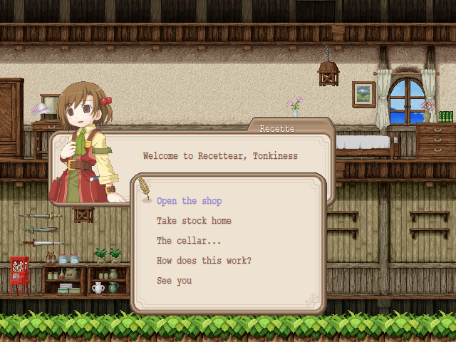
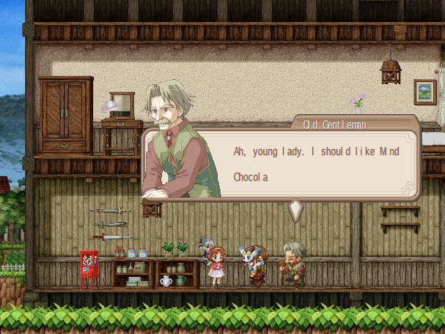
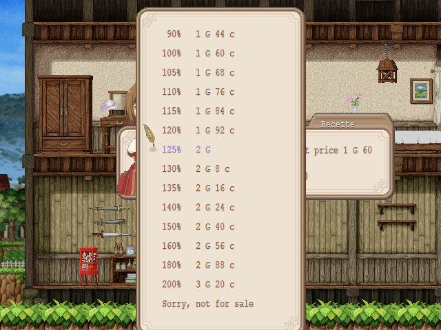
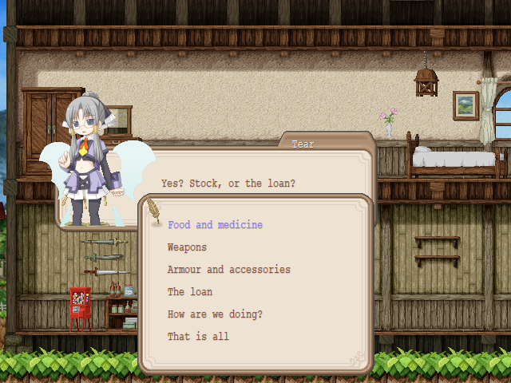
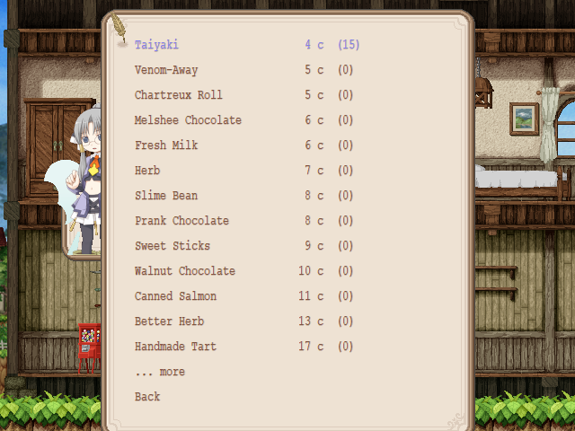
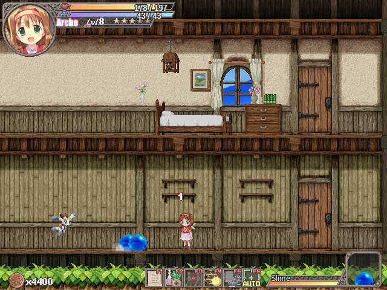
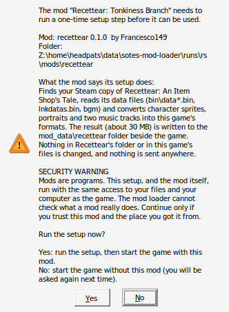
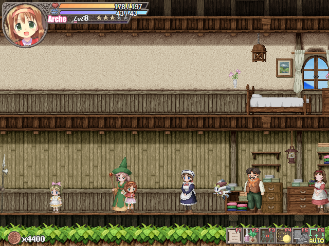
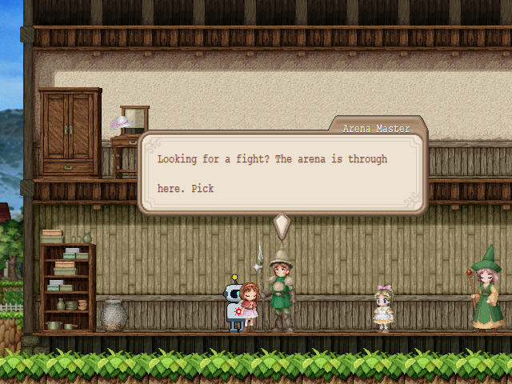

# sotes-mods

Francesco149's mods for *Fortune Summoners*, packaged for the
[**SotES Mod Loader**](../sotes-mod-loader). This repo is a **mod source**: it contains
a [`registry.json`](registry.json) the loader's launcher reads to install + update these
mods package-manager style. It ships as the loader's **default source**.

Adding this repo as a source in the launcher means you trust it to list honest files +
hashes; the launcher then verifies every downloaded file against the pinned `sha256`
(see [`../sotes-mod-loader/docs/REGISTRY.md`](../sotes-mod-loader/docs/REGISTRY.md)).

## Showcase

What the loader's content API can do today. Both mods below are Lua only, ship none of either game's
files, and load side by side. Screenshots are from the English Special Edition on Windows (the setup
prompt is from a Wine run).

### Recettear: Tonkiness Branch (`recettear`)

A crossover with *Recettear: An Item Shop's Tale*. Recette and Tear open a branch of their item shop in
the storeroom behind Arche's family shop. You order stock wholesale from Tear, mind the counter while
customers walk in and haggle, level up as a merchant and pay off the branch's loan. It is optional and
never blocks the story: customers only come back after you have been out visiting other rooms.

| | |
|---|---|
|  |  |
| Recette, Tear and the shelves in the new room; the game's own dialogue box and choice list | A Recettear customer at the counter, with his Recettear portrait |
|  |  |
| Naming a price: under the customer's limit sells, a little over gets a counter-offer | Tear, with her own portrait: wholesale orders by category, the loan, your merchant record |
|  |  |
| The wholesale list (items and prices come from the game's own item table) | Recettear's slime and mushroom as real monsters: they fight, take damage and show in the target window |
|  | |
| The one-time setup asks first, with a security warning | |

**You need your own copy of Recettear** (Steam). On first start the loader shows the prompt above; if
you agree, the mod finds Recettear through Steam, converts the sprites, portraits and shop music it
needs (about 20 seconds) and stores them in `mod_data\recettear` beside the game. Decline and the game
starts without the mod.

How each piece gets into the game, and how much of it is the game's own code:

| piece | how it is injected | how native it is |
|---|---|---|
| New door and rooms | The storeroom's map is edited in memory (widened, one wall panel turned into a door) and two new maps are built from it; they are served to the game through the loader's resource overlay, and the rooms are added to the game's room table | Fully native: the game's own map loader, door zones, room transitions and camera. No custom rendering |
| Characters and monsters | Each is a new character type on top of a stock one (a townsperson, a slime). Their sprite sheets go into new sprite banks past the game's own | Native bodies, physics, AI, combat and drawing. Only the pixels and the animation frame lists are ours. Customers are walked to the counter by a Lua tick |
| Portraits | A new 24-bit sprite bank per character; the mod sets the dialogue runner's own portrait fields | Fully native: the stock dialogue box, its portrait slot and fade |
| Dialogue, menus, gifts | Lua scripts call the same scene functions the game's own conversations use | Fully native UI. The haggling and stock menus are the game's choice list, not a custom window |
| Shop rules, stock, loan | Lua. Progress is stored in the game's story flags, so it is saved with your save file | Custom logic; storage is native |
| Music | A WAV played by the loader through DirectSound; while it plays the loader tells the engine the room has no music, so the game fades its own out and back in | Not native: a separate audio stream. It follows the game's music volume setting |
| Sound effects | Synthesized in Lua and played through the game's own sound pools | Native playback |
| Recettear's items | Five of Recettear's items (Longsword, Windbreaker, Ham Sandwich, Ferromin, Strong Concoction) become new item definitions added past the game's own item table, each a copy of the game's item of that kind with Recettear's name, description, numbers and icon. Tear hands them over as a starter kit; the cellar's slimes and mushrooms drop some | Fully native: the game's own inventory, menus, equipping, item use, floor pickups, drop roll and save files. Nothing of the game's is replaced. The icons are added below the game's own icon sheet |

Known limitations:

- Tested on the English Special Edition only (Wine and Windows). The old English
  edition and the Japanese edition have not been run with this mod.
- A save made inside the new rooms will not load if the mod is removed.
- You sell stock bought from Tear, not items from your own bag (the loader has no item-removal call yet).
- Only five of Recettear's items are added so far, and Tear's wholesale stock is still the game's own items.
- A save holding Recettear's items, loaded without the mod, loses those items (the game drops items it does not know).
- Customers and Recette's cast are side-view sprites standing on townsperson bodies: they walk and
  talk, but they are not party members and cannot fight alongside you.
- The haggling follows Recettear's idea (a price limit per customer, near-pin bonus, counter-offers,
  combos) with its own numbers, not Recettear's exact formulas.
- Under Wine the dialogue text can look unevenly spaced; that is Wine's rendering of the game's font, not the mod.

### Test Room (`testroom`) — the proof of concept

The mod the content API was built against: a new door in Arche's house leads to the Mod Hall, where
each character shows off one system.

| | |
|---|---|
|  |  |
| The hall: a new room made from the house's own tiles, with a guide, a merchant, an innkeeper, a warp mage, a bard and an arena master | The Arena Master talking; beside Arche stands Bit, a new character drawn from the mod's own sprite sheet |

| piece | how it is injected | how native it is |
|---|---|---|
| Door, hall, arena | Same as above: map edits and new maps through the resource overlay, new entries in the room table | Fully native |
| Shop, inn, storage, books, warps, quiz | Lua scripts calling the game's own shop, inn, storage box, book reader, warp and choice list | Fully native UI and rules |
| Bit and the recoloured guide | New sprite banks; Bit ships as a plain 8-bit BMP drawn for the mod | Native drawing; his patrol and dance are Lua moving a stock body |
| Glitch Cube monster | A new character type over the slime, with a new sheet in the slime's layout | Native AI and combat; the teleport and the split on death are Lua |
| Sounds and Bit's tune | Synthesized in Lua, played through the game's sound pools | Native playback |

Known limitations: the same save caveat as above; the hall has only been played by hand on the English
Special Edition (its automated test passes on all three editions).

## Mods

| id | name | what |
|---|---|---|
| `dashboard` | Loader Dashboard | The **stock loader UI**: every built-in `mod.game.*` module with an enable/disable toggle (a crash valve), persisted, + live roster stats. Recommended default. |
| `autoload` | Auto-Load Save | Launch straight into a save (config: `slot`). Orchestrates the loader's `mod.game.save` op. |
| `ennse_voice` | Japanese Voice Patch (EN-SE) | English text + Japanese dialogue voices. You supply `sotesx_s.dll` from your own JP copy. |
| `trainer` | Trainer | God mode / heal / gold / teleport to the cursor (F7) / warp to any room / give any item, every edition — over the loader's sandbox ops (api 1.2). Panels in the loader UI; `_G.trainer` for agents. Unreleased (0.1.0). |
| `recettear` | Recettear: Tonkiness Branch | A Recettear crossover (loader api 1.12): Recette and Tear run a branch of their shop behind Arche's family shop — wholesale stock, customers who haggle, merchant levels, a loan, and a starter kit of Recettear's own items added as new items. Sprites, portraits, item icons and music are converted once from your own copy of Recettear. See the showcase above. Unreleased (0.2.0). |
| `testroom` | Test Room | Proof of concept for custom content (loader api 1.10): a new door in Arche's house leads to the Mod Hall, a new room built from stock tiles where NPCs drive the game's own systems from Lua (shop, inn, books, warps, synthesized sounds), plus custom sprites — a recoloured NPC, Bit (a new character type under its own code, placed by the map: own sprite sheet + animations + a 13-second dance to his own tune) and the Glitch Cube (a new monster type: own sheet + Lua behaviours). The custom sprites live in sprite banks past the game's own. Maps are built at load from your own game data; the only shipped art is the mod's own (`bit.bmp`, `cube.bmp`, drawn by `art/make_art.py`). Unreleased (0.4.1). |

## Status

**WIP.** `autoload` and `dashboard` have loader-based releases (`autoload-1.0.0`,
`dashboard-1.0.0`); `ennse_voice` is still being **ported** from `../OpenSummoners/tools/ennse_voice`; `trainer`
(the v2 rewrite of `../OpenSummoners/tools/sotes_trainer`) is in `mods/trainer` — both keep
`registry.json` `versions[]` empty until released.

## Releases

Each mod version is published as a **GitHub release** on this repo, tagged `<id>-<version>`
(e.g. `autoload-1.0.0`), with the mod's files (`init.lua`, `mod.toml`, …) as the release
assets. `registry.json` points each version's `files[]` at those assets and pins their
`sha256`, so the launcher verifies every download against the hash it trusts.

This repo is both the **source** and the **registry**, but they're independent: a download
`url` can point anywhere, so another mod dev may keep a repo as a **registry only** and host
the mod source + files elsewhere (any GitHub release or CDN). You trust the registry you add;
the pinned hashes guarantee integrity regardless of who hosts the bytes.

## Layout

```
registry.json     the mod source manifest (the launcher reads this)
mods\<id>\         each mod's source (init.lua + assets), when ported
```
